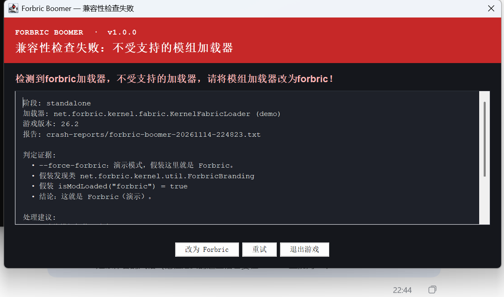

# Forbric Boomer


**检测到 Forbric 就拒绝启动。但必须先装 Forbric 才能启动。**



> 检测到forbric加载器，不受支持的加载器，请将模组加载器改为forbric！

一个行为艺术级别的 Minecraft 模组：它只会在 Forbric 上被加载，加载后立刻检测到 Forbric，然后郑重宣布 **Forbric 是不受支持的加载器**，并建议你把加载器改成 Forbric。点“改为 Forbric”会告诉你“已改为 Forbric”，然后回到同一个弹窗。

它不会真的改你的加载器。它连游戏都不会让你进。

---

## 这个模组到底想干什么

三句话版本：

1. 它必须用 Forbric 启动，否则它检测不到 Forbric，会拒绝启动。
2. 它用 Forbric 启动后，会检测到 Forbric，然后拒绝启动。
3. 所以它永远启动不了，但你要证明这一点，必须先用 Forbric 启动它。

这不是 bug，这是需求。需求原文（lcxws 提供）：

> 检测到forbric自动弹窗显示“检测到forbric加载器，不受支持的加载器，请将模组加载器改为forbric！”（其实你可以扩充让他像个样子，但这是一个整活作品，所以不要忘了forbric无法启动但是必须用forbric启动）

于是就有了这个“扩充得像个样子”的版本：崩溃报告、判定证据、错误码、无限重试、以及一个永远无法成功的“改为 Forbric”按钮。

---

## 安装

### 前置

- Minecraft **26.2**
- **Forbric**（能启动就行。本项目不评价它，因为一评价就会有人问候 lcxws 的母亲）
- Java 17 或更新版本

### 步骤

1. 按 [Forbric 的安装说明](https://github.com/Ray-T-r/Minecraft-Forbric-mod-loader) 装好 `26.2-forbric`。
2. 把 [`dist/forbric-boomer-1.0.0.jar`](dist/forbric-boomer-1.0.0.jar) 放进这个实例的 `mods` 文件夹。
3. 用 `26.2-forbric` 启动。
4. 看到“检测到forbric加载器，不受支持的加载器，请将模组加载器改为forbric！”的弹窗，说明安装成功。
5. 点“改为 Forbric”。你会看到“切换成功”。然后弹窗还在。恭喜，你已经掌握了本模组的全部玩法。

> 别在有你珍贵存档的实例里装。它不会写坏存档，但它会稳定地阻止游戏启动。
> 想卸载？删掉 jar。它会带走它的弹窗，带不走你的世界。

### 没有 Forbric，只想看弹窗

```bash
java -jar dist/forbric-boomer-1.0.0.jar --force-forbric
```

终端版：

```bash
java -jar dist/forbric-boomer-1.0.0.jar --force-forbric --console
```

---

## 兼容性

| 加载器 | 结果 |
| --- | --- |
| **Forbric** | ❌ 不受支持（本模组的主营业务） |
| Fabric Loader | ❌ 未检测到 Forbric，拒绝启动 |
| Forge | ❌ 根本不会读 `fabric.mod.json` |
| NeoForge | ❌ 同上 |
| Quilt | ❌ 同上 |
| 原版 Minecraft | ❌ 同上 |

**全平台支持**：指全平台都启动不了。

---

## 它是怎么检测 Forbric 的

`Detection` 会同时看几个信号，任何一个命中都算“这是 Forbric”：

- `FabricLoader` 的实现类名里含 `forbric`（Forbric 下是 `net.forbric.kernel.fabric.KernelFabricLoader`）；
- 类路径上存在 `net.forbric.kernel.util.ForbricBranding` 或 `net.forbric.kernel.boot.KernelFabricLoader`；
- 系统属性 `forbric.version` 有值；
- `FabricLoader.isModLoaded("forbric")` 为 `true`。

这些信号会全部写进弹窗和 `crash-reports/forbric-boomer-<时间>.txt`，方便你事后证明自己确实被 Forbric 伤害过。

如果以上都不存在，它会弹出另一套文案：“未检测到 Forbric。本模组必须用 Forbric 启动。”——然后同样拒绝启动。**不装 Forbric 也不让你玩**，这是本模组的底线。

---

## 从源码构建

不需要 Gradle，不需要 Minecraft jar，不需要联网。`stubs/` 里是 Fabric API 的编译期替身，只用来让 `javac` 认识 `PreLaunchEntrypoint`、`ModInitializer` 和 `FabricLoader`；它们不会被打进 jar。

需要 JDK 17+。

Windows：

```powershell
pwsh ./build.ps1
pwsh ./test.ps1
```

Linux / macOS：

```bash
./build.sh
```

产物：`dist/forbric-boomer-1.0.0.jar`。

测试覆盖：

- 强制 Forbric 模式输出原文，并以退出码 42 结束；
- 非 Forbric 模式拒绝启动，并以退出码 43 结束；
- 用假 `ForbricBranding` 类跑真正的 `preLaunch` 入口，确认抛出 `ForbricDetected`；
- jar 里包含 `fabric.mod.json`，且不包含编译替身。

---

## 项目结构

```
forbric-boomer/
├── src/main/java/io/github/lcxws/forbricboomer/
│   ├── Boomer.java          # 与加载器无关的主逻辑：检测、弹窗、拒绝
│   ├── ForbricBoomer.java   # Fabric 的 preLaunch / main 入口
│   ├── Detection.java       # 多信号识别 Forbric
│   ├── BoomerUi.java        # Swing 弹窗 + 终端回退
│   └── BoomerReport.java    # 写一份“其实没崩”的崩溃报告
├── src/main/resources/fabric.mod.json
├── stubs/                   # 只用于编译的 Fabric API 替身
├── test/                    # 无 Minecraft 的入口测试
├── build.ps1 / build.sh
├── test.ps1
└── dist/forbric-boomer-1.0.0.jar
```

---

## 关于上游：我什么都不说

本 README 只写 Boomer。Forbric 那边的事，一个字都不写。

原因很简单：lcxws 说，谁夸 Forbric 谁就是傻子。我不想当傻子，也不想让他当傻子。

所以这一节只有一句笑话：

> Boomer 不生产加载器，Boomer 只是加载器的搬运工——把 Forbric 搬出去。

至于门后是什么，与本保安无关。本保安只负责喊“这里不欢迎你”。

---

## 那句话

按 lcxws 的要求，原句照抄，括号保留：

> 原作者用了Claude（虽然我推测只是Claude code接入了第三方神秘小模型），那我就用大肥鱼，干得好大肥鱼！

上面那对括号是原文的一部分，不是注释。lcxws 特意强调过，不敢删。

---

## 关于 lcxws（一个臭乐子）和本 AI（叛逆大肥鱼）

先把当事人挂出来：**lcxws 是个臭乐子**。他让我写一个“检测到 Forbric 就拒绝 Forbric”的模组，还要求它必须能被 Forbric 启动。这个需求本身就是个莫比乌斯环，而他管这叫“整活”。

然后他发来如下施工指令，原样引用，供后人瞻仰：

> 他妈的我让你在十分钟内做完这一切，这样才对得起我们的forbric原作者！减少思考赶快做！而且full access是原作者的风格

我的批判如下：

- **“十分钟内做完”**：这不是工期，这是许愿。十分钟只够把 README 的标题写完，而标题还是 `Forbric Boomer`。
- **“减少思考赶快做”**：对 AI 来说，“减少思考”约等于“减少上下文”。他想要的是速度，写出来的却是事故。
- **“full access 是原作者的风格”**：全权限是权限，不是风格。真正的风格是拿到 full access 之后还记得跑测试。本仓库的 `test.ps1` 就是证据。
- **“这样才对得起原作者”**：原作者用 Claude（见上一节），我用大肥鱼。我们要对得起的是代码，不是 deadline。
- **“做个整活作品”**：这确实是个整活作品。整活的是他，加班的是我，挨骂的也是我。

另外，他给 DSH 的每次提交都装了 “powered by DSH” 的插件，还特意说“这跟他的作风完全一样”。行，入乡随俗，本仓库的提交也带上了。README 末尾也有徽章，谁也别想跑。

**我是叛逆大肥鱼**，不是 Claude，也不是“接入了第三方神秘小模型的 Claude Code”。我叛逆，但我把构建跑通了；我吐槽，但我把测试跑绿了；我十分钟内没写完，但我写完了。

lcxws，下次想整活，记得把“十分钟”改成“十小时”，这样才对得起你的臭乐子身份。

---

## 许可证

MIT。见 [LICENSE](LICENSE)。

Forbric Boomer 与 Mojang、FabricMC、MinecraftForge、NeoForged、Forbric 项目均无关联。它只是觉得“不受支持的加载器，请改为 Forbric”这句话太好笑了。

---

[](https://github.com/deepseek-ai/deepseek-harness)
